<div align="center">

  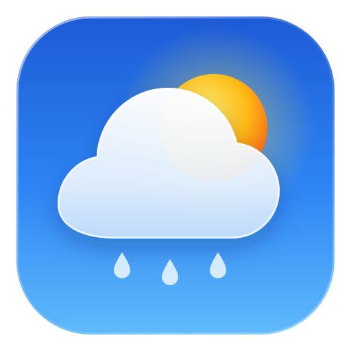

  # ⛅ CuacaKu: Live Weather & Forecast (iOS 27 Liquid Glass)

  **Aplikasi Prakiraan Cuaca Real-Time berbasis Flutter & Dart dengan desain 1:1 Apple Weather (iOS 27 Liquid Glass), Mode Terang & Gelap persisten, Arsitektur MVVM, Penyimpanan Lokal `SharedPreferences`, serta Integrasi Penuh Open-Meteo REST API.**

  **Nama** : Iqsan Azhar Nuryadi  
  **NIM** : H1D024009  
  **Shift** : Awal A / Akhir C  
  **Mata Kuliah** : Responsi Pemrograman Mobile (Flutter)

  <p align="center">
    
    
    
    
    
    
    
  </p>

</div>

---

## 📱 Production App Showcase (Emulator Android Studio)

Empat tampilan utama **CuacaKu** yang diambil langsung dari **Emulator Android Studio** dengan data cuaca *real-time* dari Open-Meteo API dan dibingkai mockup smartphone modern:

<div align="center">
  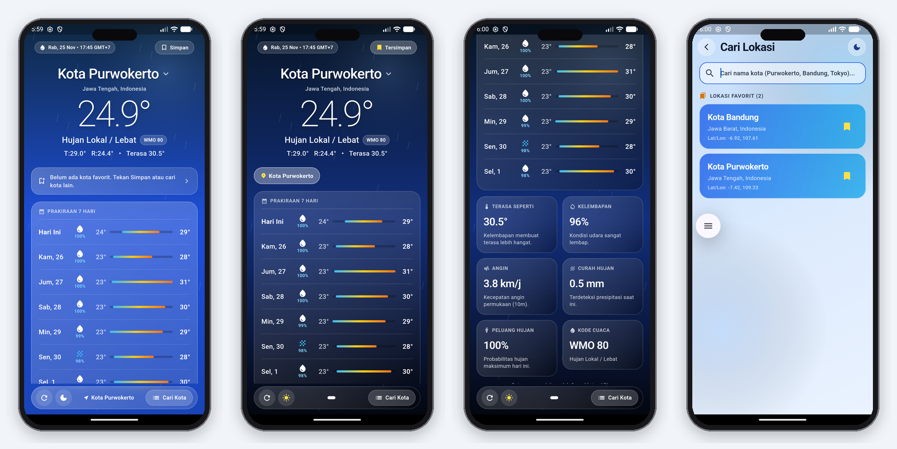
</div>

<p align="center">
  <a href="docs/demo_cuacaku.mp4">
    
  </a>
  &nbsp;
  <a href="assets/logo/cuacaku_logo.svg">
    
  </a>
</p>

---

## 📖 Tentang CuacaKu

**CuacaKu** adalah aplikasi prakiraan cuaca berbasis Flutter yang dirancang untuk memenuhi standar teknis **Responsi Flutter** dengan pendekatan kriya antarmuka (*design craft*) 1:1 ala **Apple Weather iOS 27 Liquid Glass**. Aplikasi ini memadukan kanvas langit atmosfer dinamis yang berubah sesuai kondisi cuaca (`weather_code` & `is_day`), kartu kaca translusen (*glassmorphism*) pada **Mode Terang** maupun **Mode Gelap**, serta pemisahan tanggung jawab kode yang bersih menggunakan pola **Model-View-ViewModel (MVVM)**.

Seluruh data cuaca dan daftar kota pada aplikasi ini **100% berasal dari REST API Open-Meteo** (metode `HTTP GET`), bukan data statis atau *hardcoded*, serta menyimpan lokasi favorit, riwayat pencarian, lokasi terakhir yang dibuka, dan preferensi tema secara persisten menggunakan `SharedPreferences`.

---

## 📸 Rincian Seluruh Layar & Fitur Aplikasi

Berikut adalah dokumentasi visual setiap layar aplikasi CuacaKu yang direkam dari Emulator Android Studio:

### 1. 🌤️ Home / Weather Screen (Mode Terang & Mode Gelap)
<table>
  <tr>
    <td width="270" align="center">
      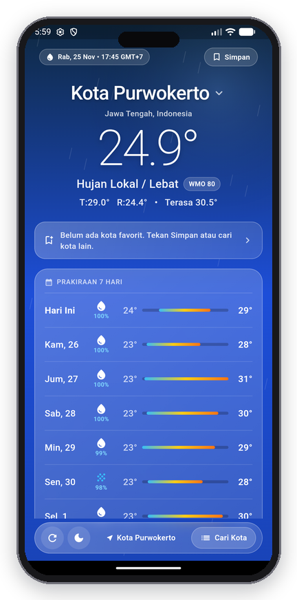
      <br/><em>Mode Terang (Light Mode)</em>
    </td>
    <td width="270" align="center">
      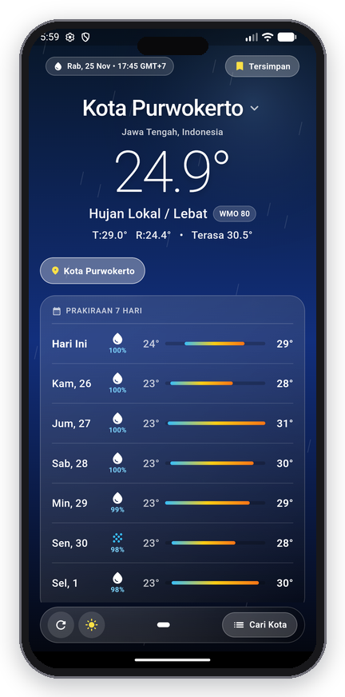
      <br/><em>Mode Gelap (Dark Mode)</em>
    </td>
    <td>
      <h4>Fitur & Fungsionalitas:</h4>
      <ul>
        <li><strong>Kanvas Langit Atmosfer Dinamis</strong>: Latar belakang menyesuaikan kode cuaca WMO (cerah, berawan, gerimis, hujan, badai petir) dan status siang/malam secara adaptif di Mode Terang dan Mode Gelap.</li>
        <li><strong>Hero Suhu Ultra-Light</strong>: Menampilkan nama kota aktif, wilayah/negara, waktu pembaruan terakhir, suhu saat ini (<code>current.temperature_2m</code>), kondisi cuaca + badge kode <code>WMO</code>, serta ringkasan suhu tertinggi/terendah dan terasa seperti.</li>
        <li><strong>Chip Lokasi Favorit</strong>: Akses cepat satu ketukan untuk berpindah antar kota favorit yang tersimpan di <code>SharedPreferences</code>.</li>
        <li><strong>Prakiraan 7 Hari & Range Bar</strong>: Daftar prakiraan harian lengkap dengan peluang hujan (<code>daily.precipitation_probability_max</code>), suhu minimum/maksimum harian, serta bilah gradien termal proporsional.</li>
        <li><strong>Floating Liquid Glass Dock</strong>: Bilah navigasi mengambang dengan efek blur (<code>BackdropFilter</code>) yang memuat tombol muat ulang, pengalih Mode Terang/Gelap, indikator titik halaman kota favorit, dan tombol menuju layar <strong>Cari Lokasi</strong>.</li>
      </ul>
    </td>
  </tr>
</table>

### 2. 📊 Bento Metrik Cuaca & Detail Prakiraan Harian
<table>
  <tr>
    <td width="270" align="center">
      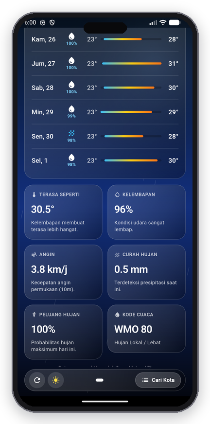
      <br/><em>Grid Metrik Liquid Glass</em>
    </td>
    <td width="270" align="center">
      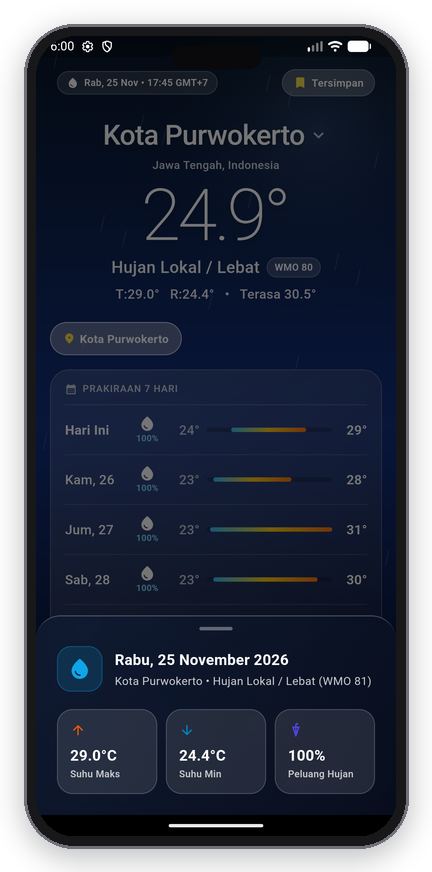
      <br/><em>Bottom Sheet Detail Harian</em>
    </td>
    <td>
      <h4>Fitur & Fungsionalitas:</h4>
      <ul>
        <li><strong>Grid Metrik 2-Kolom / 3-Kolom Responsif</strong>: Menggunakan <code>LayoutBuilder</code> untuk menampilkan seluruh metrik wajib Open-Meteo: <em>Terasa Seperti</em> (<code>apparent_temperature</code>), <em>Kelembapan</em> (<code>relative_humidity_2m</code>), <em>Angin</em> (<code>wind_speed_10m</code>), <em>Curah Hujan</em> (<code>precipitation</code>), <em>Peluang Hujan</em>, dan <em>Kode Cuaca</em> (<code>weather_code</code>).</li>
        <li><strong>Detail Prakiraan Harian</strong>: Mengetuk salah satu baris prakiraan 7 hari akan memunculkan <em>Liquid Glass Bottom Sheet</em> berisi tanggal lengkap, deskripsi WMO, suhu maksimum, suhu minimum, dan probabilitas hujan.</li>
        <li><strong>Penanganan State Lengkap</strong>: Mendukung status <em>Loading</em>, <em>Empty</em>, dan <em>Error</em> lengkap dengan tombol <strong>Coba Lagi</strong> serta <em>Pull-to-Refresh</em>.</li>
      </ul>
    </td>
  </tr>
</table>

### 3. 🔍 Search / Location Screen (Cari Lokasi & Kelola Favorit)
<table>
  <tr>
    <td width="250" align="center">
      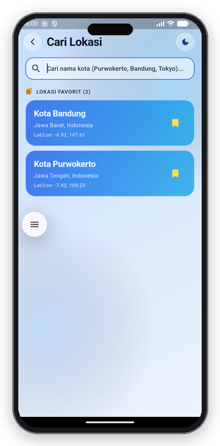
      <br/><em>Mode Terang (Favorit)</em>
    </td>
    <td width="250" align="center">
      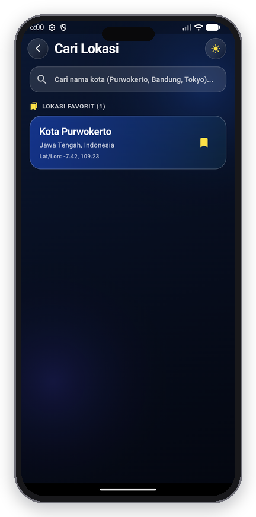
      <br/><em>Mode Gelap (Favorit)</em>
    </td>
    <td width="250" align="center">
      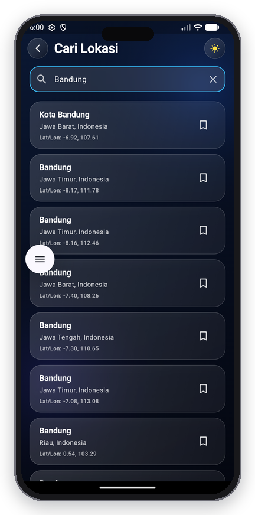
      <br/><em>Hasil Geocoding API</em>
    </td>
  </tr>
  <tr>
    <td colspan="3">
      <h4>Fitur & Fungsionalitas:</h4>
      <ul>
        <li><strong>Pencarian Kota Real-Time (Open-Meteo Geocoding API)</strong>: Input pencarian dengan <em>debounce</em> 400ms maupun tombol submit keyboard yang mengirim permintaan <code>HTTP GET</code> ke <code>geocoding-api.open-meteo.com/v1/search</code>.</li>
        <li><strong>Kartu Kaca Translusen (Glassmorphism)</strong>: Seluruh kotak pencarian, kartu hasil kota, kartu favorit bergradien, dan state umpan balik menerapkan efek <code>BackdropFilter</code> buram dengan sorotan tepi spekular di Mode Terang dan Mode Gelap.</li>
        <li><strong>Manajemen Lokasi Favorit & Riwayat Pencarian</strong>: Ketuk ikon bookmark untuk menyimpan/menghapus kota favorit. Seluruh kota favorit, riwayat pencarian (maks. 10 kota terbaru), dan kota terakhir yang dipilih tersimpan persisten di <code>SharedPreferences</code> dan otomatis dimuat kembali saat aplikasi dibuka ulang.</li>
      </ul>
    </td>
  </tr>
</table>

### 4. 🌍 Pergantian Kota Dinamis & Pembaruan Live API
<table>
  <tr>
    <td width="270" align="center">
      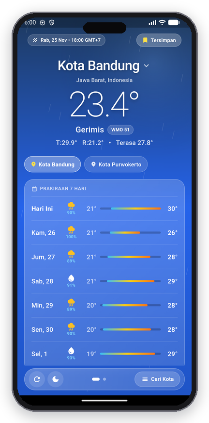
    </td>
    <td>
      <h4>Alur Pembaruan Data Antar Layar:</h4>
      <ul>
        <li>Saat pengguna memilih kota dari hasil pencarian (misal <strong>Kota Bandung</strong>), <code>SearchViewModel</code> menyimpan kota ke riwayat pencarian di penyimpanan lokal, lalu <code>WeatherViewModel</code> memanggil <code>WeatherRepository</code> untuk mengambil data prakiraan terbaru dari Open-Meteo Forecast API.</li>
        <li>Kanvas atmosfer, suhu, ikon kondisi cuaca, metrik grid, daftar 7 hari, chip favorit, serta indikator titik halaman pada <em>floating glass dock</em> langsung diperbarui secara reaktif.</li>
      </ul>
    </td>
  </tr>
</table>

---

## 🏗️ Penerapan Arsitektur MVVM (Model-View-ViewModel)

Aplikasi **CuacaKu** menerapkan pola arsitektur **MVVM** berlapis (*Layered Architecture*) dengan `ChangeNotifier` dan `Provider` agar logika bisnis, komunikasi jaringan, dan tampilan UI terpisah secara tegas:

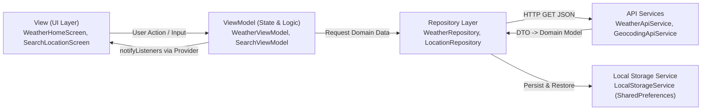

1. **Model (`domain/models/` & `data/models/`)**:
   - **Domain Models** (`LocationItem`, `CurrentWeather`, `DailyForecast`, `WeatherForecast`): Representasi objek data bersih yang dipakai oleh ViewModel dan UI.
   - **Data DTOs** (`WeatherResponse`, `GeocodingResponse`, `SavedLocationDto`): Menangani deserialisasi JSON (`fromJson`) dari respons REST API dan serialisasi JSON (`toJson`) ke `SharedPreferences`.
   - **Services & Repositories**: `WeatherApiService` dan `GeocodingApiService` melakukan panggilan `HTTP GET`; `LocalStorageService` membungkus `SharedPreferences`; `WeatherRepository` dan `LocationRepository` menjadi *single source of truth* yang mengonversi DTO menjadi model domain.
2. **ViewModel (`WeatherViewModel`, `SearchViewModel`)**:
   - Mengelola *state* UI (`initial`, `loading`, `loaded`, `empty`, `error`), *debouncing* input pencarian, *caching* daftar favorit & riwayat, serta status tema (`ThemeMode.light` / `ThemeMode.dark`).
   - Mewarisi `ChangeNotifier` dan diekspos melalui `MultiProvider` di `lib/main.dart`.
3. **View (`WeatherHomeScreen`, `SearchLocationScreen`, `ForecastDetailSheet`, & Widgets)**:
   - Terdiri dari `StatelessWidget` dan `StatefulWidget` yang bersifat deklaratif, responsif (`LayoutBuilder` 1-kolom mobile & 2-kolom desktop/tablet), dan hanya mendengarkan perubahan state dari ViewModel tanpa menyentuh HTTP client atau penyimpanan lokal secara langsung.

---

## 🌐 Implementasi REST API Open-Meteo

Seluruh komunikasi jaringan diimplementasikan menggunakan `package:http` dengan metode **HTTP GET** pada dua endpoint resmi Open-Meteo:

| Layanan | Endpoint Base URL | Parameter Query Penting |
|---|---|---|
| **Weather Forecast API** | `https://api.open-meteo.com/v1/forecast` | `latitude`, `longitude`, `current`, `daily`, `timezone=auto` |
| **Geocoding API** | `https://geocoding-api.open-meteo.com/v1/search` | `name`, `count=15`, `language=id`, `format=json` |

### Pemetaan Field API ke Antarmuka Aplikasi

| Informasi yang Ditampilkan | Field Respons JSON Open-Meteo | Properti Model Dart (`domain/models/`) |
|---|---|---|
| Suhu saat ini | `current.temperature_2m` | `CurrentWeather.temperature2m` |
| Kelembapan udara | `current.relative_humidity_2m` | `CurrentWeather.relativeHumidity2m` |
| Suhu yang dirasakan | `current.apparent_temperature` | `CurrentWeather.apparentTemperature` |
| Curah hujan | `current.precipitation` | `CurrentWeather.precipitation` |
| Kode kondisi cuaca (WMO) | `current.weather_code` | `CurrentWeather.weatherCode` |
| Kecepatan angin | `current.wind_speed_10m` | `CurrentWeather.windSpeed10m` |
| Suhu maksimum harian | `daily.temperature_2m_max` | `DailyForecast.temperatureMax` |
| Suhu minimum harian | `daily.temperature_2m_min` | `DailyForecast.temperatureMin` |
| Peluang hujan maksimum | `daily.precipitation_probability_max` | `DailyForecast.precipitationProbabilityMax` |

---

## 📂 Struktur Proyek

```text
D:\responsi_flutter\
├── assets/
│   └── logo/
│       └── cuacaku_logo.svg              # Logo aplikasi vektor SVG asli
├── docs/
│   ├── mockups/                          # Mockup smartphone berbingkai (Light & Dark)
│   ├── cuacaku_logo.png                  # Render PNG logo aplikasi
│   ├── demo_cuacaku.mp4                  # Rekaman video demo langsung dari emulator
│   └── showcase_grid.png                 # Banner showcase 4 layar utama
├── lib/
│   ├── data/
│   │   ├── models/                       # DTO JSON API & Local Storage
│   │   ├── repositories/                 # WeatherRepository & LocationRepository
│   │   └── services/                     # WeatherApiService, GeocodingApiService, LocalStorageService
│   ├── domain/
│   │   └── models/                       # LocationItem, CurrentWeather, DailyForecast, WeatherForecast
│   ├── ui/
│   │   ├── core/
│   │   │   ├── theme/                    # AppTheme (Material 3 Light & Dark ThemeData)
│   │   │   ├── utils/                    # WeatherCodeHelper (pemetaan kode WMO)
│   │   │   └── widgets/                  # AtmosphericSkyBackground, LiquidGlassCard, PressScale, StateFeedbackView
│   │   └── features/
│   │       ├── search/                   # SearchViewModel, SearchLocationScreen, LocationTile
│   │       └── weather/                  # WeatherViewModel, WeatherHomeScreen, ForecastDetailSheet, widgets/
│   └── main.dart                         # Inisialisasi service, repository, dan MultiProvider
├── test/
│   ├── data_layer_test.dart              # Unit test HTTP GET, parsing JSON, dan SharedPreferences
│   └── widget_test.dart                  # Widget test alur MVVM, Light/Dark mode, responsivitas, dan error retry
├── pubspec.yaml
└── README.md
```

---

## 🛠️ Tech Stack & Dependensi Utama

| Kategori | Teknologi / Paket | Kegunaan |
|---|---|---|
| **Framework & Bahasa** | **Flutter 3.16+ & Dart 3.2+** | Pengembangan antarmuka multi-platform berbasis widget deklaratif |
| **State Management** | **Provider (`^6.1.5+1`)** | Pengikatan `ChangeNotifier` ViewModel ke View dalam pola MVVM |
| **Networking** | **http (`^1.2.0`)** | Eksekusi request `HTTP GET` ke Open-Meteo Forecast & Geocoding API |
| **Local Storage** | **shared_preferences (`^2.2.3`)** | Persistensi lokasi favorit, riwayat pencarian, kota aktif, dan tema Light/Dark |
| **Lokalisasi Tanggal** | **intl (`^0.19.0`)** | Pemformatan nama hari dan tanggal berbahasa Indonesia (`id_ID`) |

---

## ⚡ Cara Menjalankan & Menguji Aplikasi

1. **Pasang seluruh dependensi:**
   ```bash
   flutter pub get
   ```
2. **Jalankan analisis statis (*static analysis*):**
   ```bash
   flutter analyze
   ```
3. **Jalankan seluruh unit test & widget test:**
   ```bash
   flutter test
   ```
4. **Jalankan aplikasi pada Emulator Android / Perangkat Fisik / Chrome:**
   ```bash
   flutter run
   ```

---

## 📄 Lisensi

Proyek ini dibuat untuk keperluan **Responsi Flutter Pemrograman Mobile** dan dilisensikan di bawah **MIT License**.
